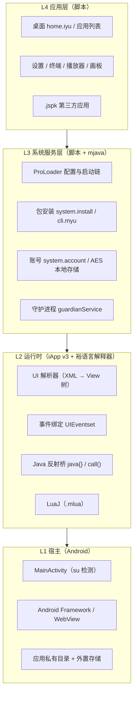
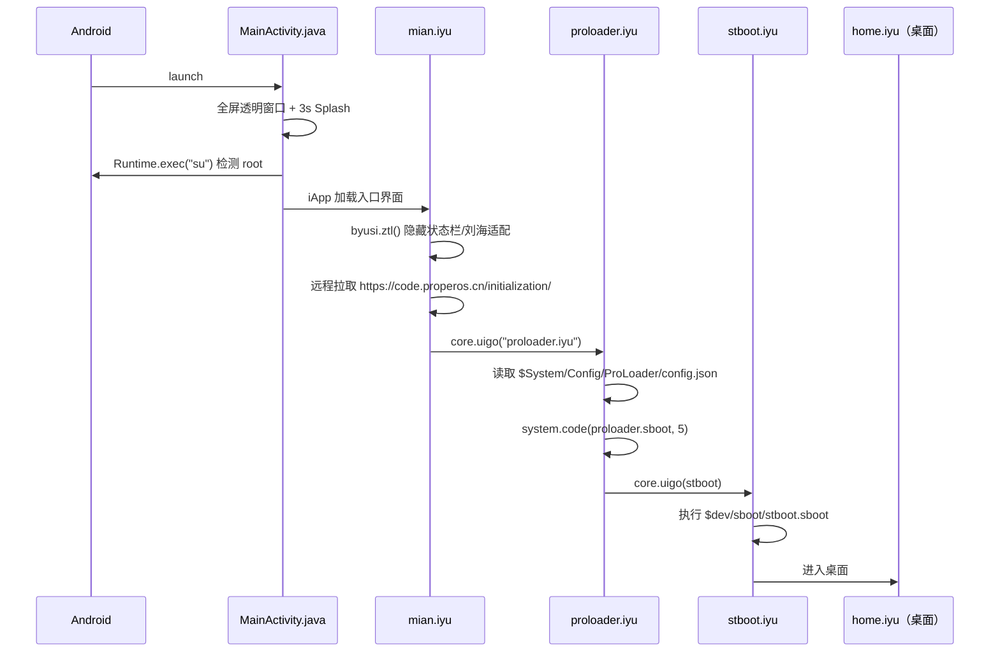

# ProperOS 2 现有代码与架构分析

> 分析对象：`https://gitee.com/properos/properos2`（HEAD `d5c3307`，`AndroidManifest.xml` 声明 `versionName=beta2.3.0`）
> 分析时间：2026-11-25

## 1. 一句话结论

**ProperOS 2 不是 Linux 发行版，也不是内核项目，而是一个运行在 Android 上的 iApp v3 应用。**
它的"操作系统"是应用内模拟出来的：UI 用 XML 声明、逻辑用"裕语言"脚本（`.iyu/.myu`）编写、系统调用通过反射桥接到 Java、文件系统映射到应用私有目录。仓库中 **不存在任何 C/汇编/内核配置/引导扇区代码**，"ProLoader / StBoot"只是应用内的两个 Activity 页面，负责按顺序加载脚本。

这个结论直接决定 2.5 的做法：**"换用新版 Linux 内核"不是升级，而是另起一个系统底座**。现有代码能保留的是设计语言、包格式语义和桌面交互，不能保留的是运行时。

## 2. 项目坐标

| 维度 | 实际值 |
|---|---|
| 应用包名 | `miao.byusi.properos.two` |
| 版本 | beta2.3.0（`versionint=265`） |
| 目标 SDK | 26（Android 8.0），`minSdkVersion=15` |
| 开发框架 | iApp v3（`build.xml` 根节点为 `<iapp>`） |
| 脚本语言 | 裕语言（`fn`/`f`/`s`/`sss`/`json` 等关键字），LuaJ 作为补充脚本引擎 |
| 原生部分 | 14 个 Java 文件（4352 行）+ `libcodecin_native.so`（自研字节码 VM） |
| 第三方 SDK | 腾讯开放平台、微博、Gson 2.14、OkHttp 4.12、NanoHTTPD、ExoPlayer 系、Termux 终端三件套（`terminal-emulator/view/shared-0.114.aar`） |
| 许可 | MIT + AGPL 双协议（beta2.2.8 起） |

## 3. 运行时分四层



关键点：**没有系统调用、没有进程隔离、没有设备驱动**。所有"系统能力"最终都落到 Android Framework 的 API 上，权限上限等于宿主 App 被授予的 Android 权限。

## 4. 源码结构与文件类型矩阵

| 扩展名 | 数量 | 行数 | 作用 | 说明 |
|---|---:|---:|---|---|
| `.iyu` | 27 | 5435 | 界面 + 事件 | 根节点是 `<View>`，尾部 `<UIEventset>` 挂 `loading/loadingComplete/clicki/downkey` 事件 |
| `.myu` | 19 | 3474 | 模块 / 函数库 | 纯逻辑，`fn name(args)` 定义、`end fn` 结束 |
| `.mjava` | 20 | 1573 | 内嵌 Java 片段 | 以源码形式存放，运行时编译注入，如 `aes.mjava`、`codeProcessor.mjava` |
| `.mlua` | 2 | 45 | Lua 脚本 | `cmd.mlua` 提供 `shell()/sh()`，用 `io.popen` 执行命令 |
| `.java` | 14 | 4352 | 正式 Java 类 | `MainActivity`、`proLoader`、`codecin`、`TerminalTool` 等 |
| `.mtsx` | 3 | — | 编辑器语法高亮配置 | 给 MT 管理器用，不参与构建 |
| `sdk/*.aar、*.jar` | 12 | — | 预置依赖 | 不经过 Gradle，由 iApp 打包时合入 |
| `apk/assets` | 18 MB | — | 第三方 SDK 资源 | QQ/微博登录相关 |

`main/` 目录是 iApp 的"原生资源覆盖层"：`AndroidManifest.xml`、`res/layout/dialog_show_message.xml`、`res/raw/apt_info_script.sh`（Termux 的 apt 信息采集脚本）。`cso/set.xml` 只有一行 `<isCustom>false</isCustom>`，是打包器配置。

## 5. 真实启动链



`proLoader.java` 只是把同样的流程用 Java 重写了一遍（读 config、起线程 `Thread.sleep(sleep)` 显示 logo、再 `core.uigo(stboot)`），通过反射调用 `androidx.Yu3Java.yu()` 执行裕语言代码。**"引导"的实质是"按配置顺序切界面"，没有硬件初始化、没有内核加载、没有分区表操作。**

## 6. 虚拟文件系统

路径前缀由 `proLoader.convertPath()` 硬编码映射：

| 前缀 | 实际位置 | 用途 |
|---|---|---|
| `$` | `/data/data/miao.byusi.properos.two/files/` | 系统分区（`$System`）、用户区（`$user`）、设备区（`$dev`） |
| `@` | 同上（与 `$` 等价） | 内置只读资源，如 `@about.json`、`@System/BootUp/` |
| `%` | `/sdcard/` | 外置存储，用于导入导出 |
| 无前缀 | 原样 | 绝对路径 |

由此衍生出的"目录规范"：`$System/Config/ProLoader/config.json`、`$System/BootUp/stboot.sboot`、`$dev/sboot/stboot.sboot`、`$user/data/software/<pkg>`、`$ProperOS/home/Desktop/<uuid>.plink`。这套规范是 2.5 唯一值得原样继承的东西——它已经形成了稳定的语义（系统区/用户区/设备区/桌面项）。

## 7. 包管理与应用安装

`.jspk` 是 zip 包，必须包含 `MainIndex.json`：

```json
{
  "system": false,
  "name": "应用名",
  "package": "com.example.app",
  "sign": { "uuid": "...", "byusi": { "uuid": "...", "email": "..." } }
}
```

`system.install()` 的实际流程：

1. `fuz()` 解出 `MainIndex.json` 到 `$temp/<timestamp>`；
2. 若 `system=true`，取 `sign.byusi.uuid/email`，请求 `https://api.www.cdifit.cn/user/query.php` 校验开发者；
3. 非系统应用同样要查一次开发者，然后弹窗让用户确认"应用名/包名/开发者"；
4. 复制 `MainIndex.json` 为桌面项 `$ProperOS/home/Desktop/<uuid>.plink`；
5. `fuzs()` 整包解压到 `$user/data/software/<package>`。

问题很明确：

- **签名没有密码学校验**。`sign` 只是 JSON 里的 uuid/email，任何人可以伪造；代码里还有 `s status ="success"` 这种把校验结果写死的行（`system.myu:40`、`system.myu:110`），联网校验实际上被短路。
- **离线不可安装**：查不到开发者就直接拒绝（"请联网进行应用安装"）。
- **没有依赖、版本、冲突、卸载**：`cli.uninstall()` 只有一句 `tw.tw2("抱歉还没有实现删除逻辑")`。
- **`ppkg` 包管理器不存在**：`更新计划.md` 里"添加软件包管理器"仍未勾选，仓库内 grep 不到 `ppkg` 实现。

## 8. 权限模型

三层，且都不是真正的权限：

| 层 | 实现 | 实质 |
|---|---|---|
| Android 层 | `MainActivity.checkRootAccess()` 执行 `su`，`exitCode==0` 视为有 root | 只是探测设备是否已 root，失败仅弹窗提示，不阻断启动 |
| 系统层 | `ProLoader/config.json` 的 `enable_supan`、`enable_strict_perm` | 两个布尔值，供 UI 显示"已获取系统管理员权限"，没有任何执行侧拦截 |
| 应用层 | 无 | 第三方 `.jspk` 解压后即可被 `system.code()` 执行，不做沙箱 |

所谓 **supan（Super Admin）** 是纯展示型开关。2.5 若要做容器，权限必须重建为：`sudo/polkit` 提权 + 特权代理（`supand`）+ 明确的 capability 白名单，而不是一个 JSON 布尔。

## 9. 终端与容器现状

- `terminal.iyu` + `TerminalTool.java` + `sdk/terminal-*.aar`：自带一个终端视图，但只是把命令丢给外部 Termux；
- `termux.myu` 用 `ProcessBuilder` 直接调 `/data/data/com.termux/files/usr/bin/bash`，环境变量写死 `PREFIX=/data/data/com.termux/files/usr`；
- **强依赖用户自行安装 Termux**，未安装则整条链路失败；
- `main/res/raw/apt_info_script.sh` 是 Termux 官方 apt 信息脚本的副本，靠 `@TERMUX_PREFIX@` 占位符替换；
- 没有任何 chroot / proot / namespace / cgroup 操作，因此"容器"只是"调用另一个 App 的 shell"。

## 10. 工程质量评估

**值得肯定的部分**

- 目录语义清晰（`$System/$user/$dev`），桌面项 `.plink` 与包清单 `MainIndex.json` 解耦得比较干净；
- UI 层做了统一封装（`with_ui.myu` 1703 行、`shader.myu` 控件着色、`model.myu` 事件注入），换皮成本低；
- 有配置驱动的启动器（`config.json` 控制 logo、延时、StBoot 界面、控制台开关），思路接近 bootloader 的 boot entry。

**必须正视的问题**

| 类别 | 具体问题 |
|---|---|
| 安全 | 远程代码直接执行：`initialization.iyu` 拉取 `https://code.properos.cn/initialization/` 后 `system.code(web_code,7)`，无签名、无哈希校验 |
| 安全 | 账号接口走明文 HTTP 参数拼接（`system.myu:219`），AES 密钥从响应里的 `uuid` 派生并本地存储 |
| 安全 | 安装校验被硬编码为 `success`，签名可伪造 |
| 稳定 | `termux.myu` 里 `t()` 嵌套线程 + `syso(e)` 在无异常时也执行，异常变量作用域混乱 |
| 可维护 | 业务逻辑与 UI 混写，单文件 1703 行；`mian.iyu` 中插入大量空行做"防盗版" |
| 可移植 | 100% 绑定 iApp v3 与 Android API，无法在 x86 PC 上运行 |

## 11. 对 2.5 的可复用资产

| 资产 | 复用方式 |
|---|---|
| 路径语义（`$System/$user/$dev`） | 直接映射为 FHS：`/system`、`/home`、`/dev`，保留原命名作为兼容软链 |
| `MainIndex.json` 清单 | 升级为 `.jspk 2.0`：保留字段，新增 `arch/deps/version/digest`，签名改为 Ed25519 + 内容哈希 |
| `.plink` 桌面项 | 保留为 `.desktop` 的生成源，字段一一对应 |
| ProLoader `config.json` | 升级为 `/etc/proloader/proloader.conf`，`boot` 段对应 boot entry |
| 控件着色 / UI 封装思路 | 迁移到 GTK4/Qt 主题或 Web 壳的 design token |
| `codecin` 字节码 VM | 作为 2.5 的应用运行时之一（沙箱内执行），但不再是系统唯一执行入口 |

**不能复用**：iApp 运行时、裕语言解释器、Android 权限模型、Termux 外挂方式、现有 `.jspk` 的校验逻辑。
