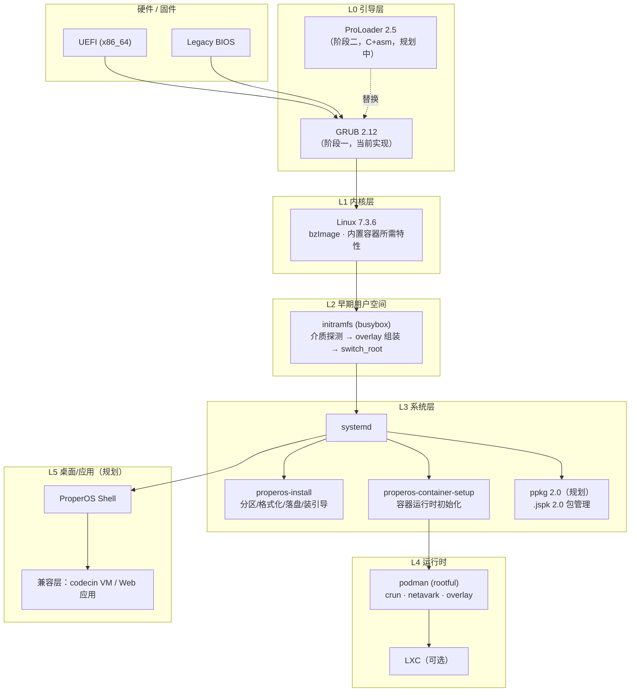
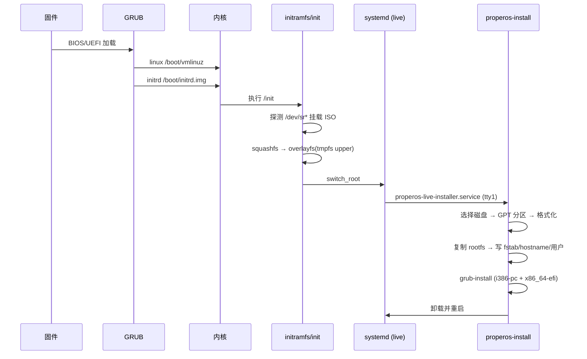

# ProperOS 2.5 架构设计

## 1. 需求与现实的差距

目标：**用最新 Linux 内核开发 ProperOS 2.5，产出安装引导镜像，并预置可 root 运行的容器环境。**

现有仓库的实际情况（见 [01 文档](01-现有代码与架构分析.md)）：完全没有内核代码，没有引导扇区，没有 init，没有块设备操作。它是一个 Android 应用。因此"把 ProperOS 2 升级到 2.5"在工程上等价于：

> 保留 ProperOS 的产品语义（启动器配置、桌面项、包清单、系统/用户/设备分区划分），替换整个运行时底座。

这不是版本迭代，是**换底座**。凡是声称"改几行就能换内核"的方案都不成立。

## 2. 三条路线的取舍

| 路线 | 做法 | 结果 | 判断 |
|---|---|---|---|
| A. 继续 Android 壳 | 保留 iApp，接入 Termux + proot/chroot | 能得到"带 root 的容器"，但仍是 App，不是操作系统，无安装镜像 | 可作为过渡，不满足"内核 + 引导镜像" |
| B. 基于 Linux 内核的新发行版 | 自编内核 + initramfs + rootfs + ISO + 安装器 | 满足全部三项要求，可与 ProLoader 对接 | **采用** |
| C. 基于现成发行版二次打包 | 用 Debian/Ubuntu 内核与 live-build | 快，但"最新内核 + 自研引导"不可控 | 作为构建手段借用，不作为产品形态 |

**结论：走 B，构建手段借用 C（debootstrap + 自编内核），产品形态是独立发行版。**

## 3. 2.5 分层架构



设计原则：

1. **内核不带补丁**。用上游 stable，容器所需能力全部走主线特性，避免维护成本；发行版差异只体现在配置与用户空间。
2. **安装器与运行时同源**。live 环境与安装后的系统是同一套 rootfs，安装即"复制 + 重配置"，不存在两套包集合。
3. **引导层可替换**。ProLoader 作为 GRUB 的同级后端接入，通过 `boot entry` 描述文件对接，不绑定具体引导器。
4. **权限可审计**。删除 2.x 的 JSON 布尔开关，改为 sudo/polkit + 明确的 capability 白名单。

## 4. 内核选型与配置

| 项 | 选择 | 理由 |
|---|---|---|
| 版本 | **7.3.6**（stable） | 当前最新稳定版；容器特性（cgroup v2、overlayfs、user ns、netavark 依赖的 nftables）均已成熟 |
| 备选 | 6.18.65（LTS） | 需要长期支持时切换，只需改 `KVER`/`KMAJOR` 两个变量 |
| 配置基线 | `x86_64_defconfig` + 定向增删 | 保证硬件兼容性，同时裁掉媒体/无线/蓝牙以缩短编译与缩小体积 |
| 模块策略 | 关键驱动全部 `=y` | 目标系统不生成 initrd，直接 `root=PARTUUID` 挂载，减少故障面 |

必须内置的能力（缺一不可）：

```text
命名空间   NAMESPACES USER_NS PID_NS NET_NS IPC_NS UTS_NS
资源控制   CGROUPS CGROUP_PIDS CGROUP_FREEZER CGROUP_BPF MEMCG
文件系统   OVERLAY_FS FUSE_FS TMPFS EXT4_FS BTRFS_FS SQUASHFS ISO9660_FS
网络       VETH BRIDGE NETFILTER NF_NAT IP_NF_NAT IP_NF_TARGET_MASQUERADE
           NETFILTER_XT_MATCH_ADDRTYPE BRIDGE_NETFILTER
安全       SECCOMP SECCOMP_FILTER BPF_SYSCALL CGROUP_BPF CGROUP_DEVICE BPF_JIT
存储/总线  VIRTIO_BLK VIRTIO_NET SCSI_VIRTIO SATA_AHCI BLK_DEV_NVME USB_XHCI_HCD
引导/显示  EFI EFI_STUB BLK_DEV_INITRD RD_XZ DRM_SIMPLEDRM FRAMEBUFFER_CONSOLE
```

完整配置已固化为 `kernel/properos_2.5_defconfig`，可复现。

## 5. 安装引导镜像

### 5.1 介质结构

```text
ProperOS-2.5-arm64.iso  (ISO 9660 + El Torito(UEFI) + squashfs live 根)
├── boot/
│   ├── vmlinuz                  Linux 7.3.6 bzImage
│   ├── initrd.img               busybox initramfs
│   └── grub/
│       ├── grub.cfg             启动菜单（安装/详细日志/串口/本地磁盘）
│       └── i386-pc/…            BIOS 阶段一
├── EFI/BOOT/BOOTX64.EFI         UEFI 回退引导（--removable，免 NVRAM 写入）
├── live/rootfs.squashfs         完整 live 系统（xz 压缩）
└── README.txt
```

### 5.2 启动与安装流程



关键点：

- **live 根可写**：squashfs 只读 + tmpfs 上层做 overlay，systemd 正常启动，所有修改在内存中，重启即还原。
- **不生成目标 initrd**：内核把 ext4/ahci/nvme/virtio 全部内置，`root=PARTUUID=…` 直接挂载，少一个失败点。
- **双模式引导**：同一 ISO 同时写 El Torito(BIOS) 与 ESP(UEFI)；安装时两个 `grub-install` 都执行，装到 U 盘也能在两种机器上启动。
- **无人值守**：`properos-install --disk /dev/vda --yes`，便于批量部署与自动化测试。

### 5.3 分区方案

| 分区 | 大小 | 类型 | 挂载 |
|---|---|---|---|
| 1 | 1 MiB | BIOS Boot（`bios_grub`） | 无，供 GRUB 嵌入 core.img |
| 2 | 512 MiB | ESP (FAT32) | `/boot/efi` |
| 3 | 剩余 | ext4（默认）/ btrfs（`@` + `@home` 子卷） | `/` |

最小磁盘 8 GiB；不单独划 swap，默认使用 zram（后续版本）。BIOS 与 UEFI 共存时必须保留 1 MiB 的 `bios_grub` 分区，否则 GRUB 只能退回不可靠的 blocklists 方式并拒绝安装。

## 6. 容器方案（root 权限运行）

| 决策 | 选择 | 说明 |
|---|---|---|
| 引擎 | **podman** | 无守护进程，rootful 直接使用宿主 root，符合"配合 root 权限运行"；CLI 兼容 docker |
| 模式 | rootful | 系统级容器、端口 <1024、挂载整块设备等场景必需；rootless 作为附加能力保留 |
| OCI 运行时 | crun | 启动快、内存占用低，podman 在 Debian 的默认 |
| cgroup | v2 | 统一层级，`systemd` cgroup manager |
| 存储 | overlay（fuse-overlayfs 兜底） | 需要内核 OVERLAY_FS；容器内写时复制 |
| 网络 | netavark + nftables | 替代 CNI，支持端口映射、自定义网络 |
| 镜像加速 | `docker.m.daocloud.io` → `dockerproxy.net` | 国内可用性优先，可在 registries.conf 替换 |

安全基线（默认生效，需显式放开）：

```text
no-new-privileges = true      # 禁止 setuid 提权
pids_limit        = 2048      # 防 fork 炸弹
default_capabilities          # 14 项基础能力，不含 CAP_SYS_ADMIN
allow_privileged  = false     # --privileged 需手工指定
```

"配合 root 权限"不是"默认全放权"。默认给容器 root（rootful），但**不给宿主内核的完全控制权**；需要 `--privileged` 时必须显式声明并在审计日志留痕。

## 7. 包管理 2.0（规划）

`.jspk` 保留 zip 容器与 `MainIndex.json`，补齐 2.x 缺失的部分：

```json
{
  "schema": 2,
  "name": "示例应用",
  "package": "com.example.app",
  "version": "1.2.0",
  "arch": ["x86_64"],
  "deps": ["libgtk-4-1>=4.10"],
  "entry": "/usr/bin/example",
  "digest": "sha256:…",
  "signature": { "algo": "ed25519", "key": "…", "sig": "…" }
}
```

- 校验：内容哈希 + Ed25519 签名，公钥内置在 `/etc/ppkg/trusted.d/`；
- 安装：解包到 `/opt/<pkg>/`，链接到 `/usr/bin`，注册 `.desktop`；
- 卸载：按清单反向删除，保留 `/etc` 与用户数据（`--purge` 才清）；
- 与容器打通：`ppkg install --oci docker.io/library/nginx:alpine` 可直接落成容器应用。

## 8. 与 2.x 的资产映射

| 2.x | 2.5 | 迁移动作 |
|---|---|---|
| `$System` | `/etc/properos` + `/usr/lib/properos` | 配置与只读资源分离 |
| `$user` | `/home/<user>` | 直接对应 |
| `$dev` | `/dev` + `/run/properos` | 运行时状态 |
| `$ProperOS/home/Desktop/*.plink` | `/usr/share/applications/*.desktop` | 字段映射，生成器自动转换 |
| `ProLoader/config.json` | `/etc/proloader/proloader.conf` | 见 `installer/proloader.conf` |
| `.sboot` 启动脚本 | systemd unit / init 脚本 | 脚本语义保留，执行器替换 |
| `supan` 布尔 | sudo + polkit + capability 白名单 | 重写 |
| `main.iyu` 桌面 | ProperOS Shell（规划） | UI 重做，交互规范沿用 |

## 9. 实施阶段

| 阶段 | 内容 | 状态 |
|---|---|---|
| P0 | 架构分析、内核配置、构建流水线 | 已完成 |
| P1 | 可引导 ISO、安装器、rootful 容器预置 | 已完成（本仓库） |
| P2 | ProLoader 2.5 接管引导（C+asm，BIOS/UEFI） | 待做，接口已留（`proloader.conf`） |
| P3 | ppkg 2.0 + Shell + 2.x 应用兼容层 | 待做 |

## 10. 风险与对策

| 风险 | 影响 | 对策 |
|---|---|---|
| 自编内核缺目标机驱动 | 装完起不来 | 保留 `x86_64_defconfig` 全量硬件支持；提供 `--fs btrfs` 与 recovery 条目 |
| 无 initrd 导致特殊存储不可用 | NVMe RAID / LVM 无法挂载 | P2 增加可选 initrd 生成（dracut） |
| UEFI Secure Boot | 自签内核被拒 | 文档说明关闭 Secure Boot 或后续用 shim + MOK 签名 |
| 容器镜像拉取失败 | 无法初始化 | 双镜像源 + `--offline` 模式跳过网络校验 |
| 安装器误擦盘 | 数据丢失 | 强制输入 `YES`；`--disk` 显式指定才可 `--yes` 跳过 |
